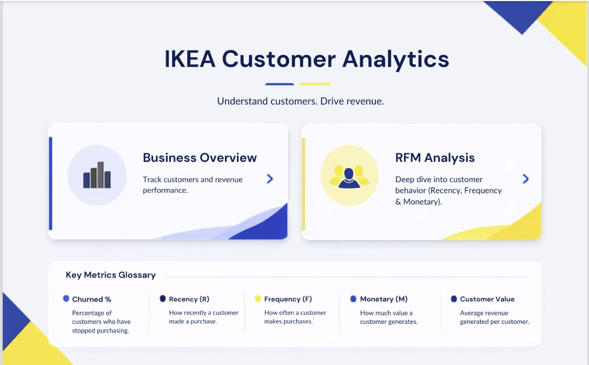
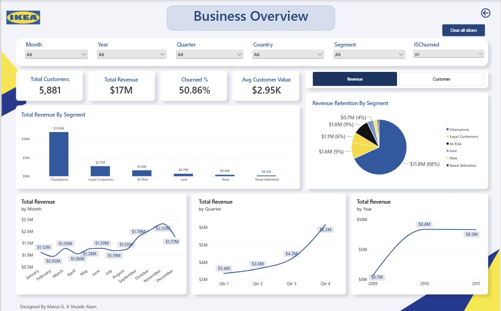

# IKEA Customer Analytics

### Retail Analytics | Customer Segmentation | RFM Analysis


## Project Overview

IKEA Customer Analytics is an end-to-end data analytics project developed to explore retail transaction data, understand customer purchasing behaviour, analyse revenue performance, and identify valuable customer segments.

The project combines SQL Server, Python, Microsoft Excel, and Power BI to perform data preparation, customer analysis, RFM segmentation, and business intelligence reporting.

The main objective is to transform raw retail transaction data into meaningful insights that can support better business and customer-related decisions.

## Project Objectives

- Organise and combine retail transaction data using SQL Server.
- Perform data quality checks and identify duplicate records.
- Analyse customer purchasing behaviour using Python.
- Calculate Recency, Frequency, and Monetary (RFM) metrics.
- Assign RFM scores and classify customers into different segments.
- Identify potentially churned customers.
- Develop interactive Power BI dashboards to present business insights.

## Technologies Used

| Technology | Purpose |
|---|---|
| SQL Server / SSMS | Database creation, data combination and validation |
| Python | Data analysis and customer segmentation |
| Pandas | Data manipulation and processing |
| Jupyter Notebook | Python analysis environment |
| Microsoft Excel | Analytical output |
| Microsoft Power BI | Dashboard development |

## Project Workflow

### 1. SQL Server – Database Preparation

- Created the ECommerceCustomerAnalytics database.
- Worked with two retail transaction tables covering 2009–2010 and 2010–2011.
- Combined transaction records into a consolidated table.
- Performed data quality checks.
- Identified missing values, invalid records, and duplicate transactions.
- Created a cleaned transaction table.

### 2. Python – Data Analysis

- Loaded the cleaned transaction dataset using Pandas.
- Processed transaction dates and customer information.
- Prepared data for customer-level analysis.
- Calculated Recency, Frequency, and Monetary values.
- Assigned RFM scores using quintile-based scoring.
- Classified customers into different segments.
- Identified potentially churned customers using a 90-day threshold.
- Exported the analytical results into Excel.

### 3. RFM Customer Segmentation

RFM analysis is used to understand customer purchasing behaviour through three important metrics:

- **Recency:** How recently a customer made a purchase.
- **Frequency:** How frequently a customer makes purchases.
- **Monetary:** How much a customer spends.

The project classifies customers into six segments:

- Champions
- Loyal Customers
- At Risk
- New
- Need Attention
- Lost

### 4. Power BI – Dashboard Development

Developed an interactive dashboard with three main pages:

**Home Page**
- Project introduction.
- Dashboard navigation.
- Key metrics glossary.

**Business Overview**
- Total customers.
- Total revenue.
- Customer churn percentage.
- Average customer value.
- Revenue by customer segment.
- Monthly, quarterly, and yearly revenue analysis.

**RFM Analysis**
- Customer segment performance.
- Customer distribution.
- Revenue by segment.
- Average RFM scores.
- Churn analysis.

## Dashboard Preview

### Home Page



### Business Overview



### RFM Analysis


## Repository Structure

```text
IKEA-Customer-Analytics/
│
├── SQL/
│   ├── 01_Database_Setup.sql
│   ├── 02_Data_Combination.sql
│   ├── 03_Data_Quality_Checks.sql
│   ├── 04_Missing_Values_Duplicates.sql
│   └── 05_Data_Cleaning.sql
│
├── Python/
│   ├── Customer_RFM_Analysis.ipynb
│   ├── RetailCleaned.csv
│   └── requirements.txt
│
├── PowerBI/
│   └── IKEA Dashboard.pbix
│
├── Output/
│   └── Customer_RFM_Analysis_Sample.xlsx
│
├── Screenshots/
│   ├── Home.jpeg
│   ├── Overview.jpeg
│   └── RFM Analysis.jpeg
│
├── Assets/
│   ├── IKEA Logo.png
│   └── IKEA Project Theme.json
│
├── README.md
└── .gitignore
```

## Dataset Information

The project uses a retail transaction dataset maintained locally by the project author.

**Important dataset information:**

- The complete original dataset is stored locally and is not publicly available through a download link.
- The full dataset is not included in this GitHub repository.
- A sample dataset containing 10,000 transaction records is included for demonstrating and testing the Python analysis.
- The included Excel output is generated using the sample dataset.
- The Power BI dashboard was developed using the original full dataset.

The sample dataset is intended for demonstration purposes. Therefore, its analytical results may differ from the original full-dataset dashboard results.

Users who want to reproduce the complete analysis will need access to the original dataset and the corresponding database tables.

## How to Run the Project

### Python Analysis

1. Clone or download this repository.
2. Install Python and Jupyter Notebook.
3. Navigate to the Python folder.
4. Install the required libraries:

```bash
pip install -r requirements.txt
```

5. Open `Customer_RFM_Analysis.ipynb`.
6. Ensure `RetailCleaned.csv` is available in the same folder.
7. Run all notebook cells.

The notebook will perform RFM analysis, customer segmentation, and generate an Excel output.

### SQL Analysis

1. Install Microsoft SQL Server and SQL Server Management Studio.
2. Create the ECommerceCustomerAnalytics database.
3. Import the required source transaction tables.
4. Execute the SQL scripts in the appropriate order.

The original source datasets are not included in this repository, so the complete SQL workflow requires the locally maintained transaction data.

### Power BI Dashboard

1. Open `IKEA Dashboard.pbix` using Power BI Desktop.
2. Explore the Home, Business Overview, and RFM Analysis pages.
3. To refresh the report, provide access to the original Excel data source and update its connection if required.

## Key Learning Outcomes

- SQL database management and querying.
- Data preparation and quality validation.
- Python data analysis using Pandas.
- RFM-based customer segmentation.
- Customer churn identification.
- Business intelligence and dashboard development.
- Converting transaction data into meaningful business insights.

## Author

**Shoaib Alam**

BCA Student | Aspiring Data Analyst

GitHub: [ShoaibAlam06](https://github.com/ShoaibAlam06)

---

*This project was developed for learning and practical application of data analytics, customer segmentation, and business intelligence techniques.*